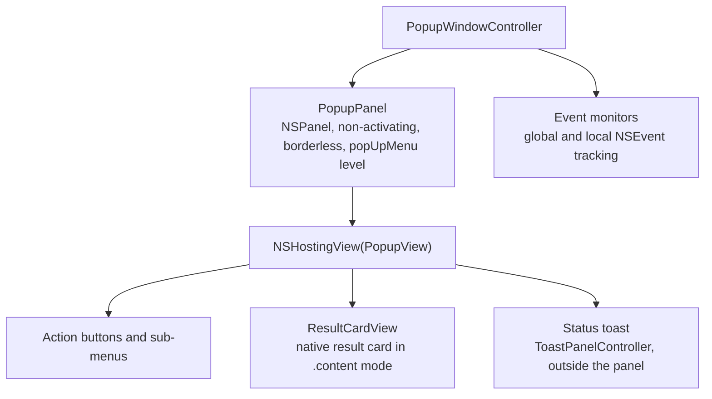

# Floating popup panel architecture

The floating popup panel subsystem presents contextual actions near the user's cursor or text selection. It consists of `PopupPanel` (an `NSPanel` subclass), static frame math in `PopupPositioner`, SwiftUI rendering in `PopupView`, and lifecycle coordination via `PopupWindowController`.

## Window components



### 1. [`PopupPanel`](../../Sources/OpenClip/UI/Popup/PopupPanel.swift)
- **Base Class**: `NSPanel`
- **Window Style**: `.nonactivatingPanel`, `.borderless`
- **Window Level**: `.popUpMenu` (sits above all normal, floating, and status-bar windows; only system menus and the screen saver stack higher). The panel is deliberately never the key window by default. Making it key would steal keyboard focus from the active app and swallow keystrokes. There are two scoped exceptions, action-search mode and content (AI-card) mode: `PopupPanel.allowsKey` gates `canBecomeKey`/`canBecomeMain`, enabled by `PopupWindowController.enterSearch()` and `enterKeyMode()` (search and content both route through the same `enterKeyMode()`/`exitKeyMode()` primitives).
- **Properties**: `isOpaque = false`, `backgroundColor = .clear`, `hasShadow = false` (SwiftUI draws its own shadow; a panel shadow causes double artifacts). `pinBottomEdgeOnResize` (search/content mode only) re-anchors content-driven growth, see *Action-search palette and panel growth* below.
- **Shadow inset**: `PopupView` keeps `PopupMetrics.popupShadowInset` (16pt) of SwiftUI padding around the bar and AI result card so the SwiftUI shadow renders inside the panel rather than being clipped at its edge. If a shadow looks cut off, increase the padding. Never re-enable the panel shadow. That padding ring is fully transparent but still part of the window frame, which originally made shadow clicks do nothing: the panel was topmost at those pixels, the local event counted as "in the bar", and no app received the click. Two layers now handle it: (1) every click/right-click dismissal check uses `isOverPanelContent` (frame minus ring), so a press in the shadow always dismisses; (2) while the pointer hovers the ring, `updatePopupHover` sets `panel.ignoresMouseEvents = true`, so the click genuinely falls through to the app underneath and the global monitor observes it. The ignores-toggle requires global monitoring (Accessibility). Without AX, layer 1 alone still guarantees dismissal, though the underlying app won't receive the swallowed ring click.

### 2. [`PopupWindowController`](../../Sources/OpenClip/UI/Popup/PopupWindowController.swift)
- **Responsibility**: Controls window creation, display lifecycle, event monitoring, hover tracking, and the popup mode state machine (actions bar ↔ search palette ↔ content/AI-card).
- **Event Handling**: Sets up local and global `NSEvent` monitors (`.leftMouseDown`, `.mouseMoved`, `.scrollWheel`, `.keyDown`). The local monitor sees mouse events over the panel; the global monitor sees events system-wide.
- **Dismissal Threshold**: Automatically dismisses the popup if the cursor moves beyond `PopupMetrics.popupDismissalDistance` (suspended in search mode and while a content/AI-card is open). For the result card, un-dragged cards dismiss normally on outside click or app switch. If the user drags the card (`hasUserMovedCard`), `cardIsModal` pins the card against outside clicks and document scrolls until Copy, Paste, Close or Esc. Switching active applications or spaces still dismisses it.
- **Keyboard Dismissal**: Requires Accessibility permission (the global monitor). In actions mode any key, including `Escape`, dismisses the popup. The global monitor is observation-only, so the keystroke still lands in the source app's document and the panel never needs to become key. In search mode the panel is key, so keys go to the search field (`Escape` clears a scoped query, then exits). In content mode the panel is also key: the AI result card owns all keys via SwiftUI `.onKeyPress`, `Escape` closes the card (`hide()`), and the controller monitor stays observation-only so it never double-fires Esc. The one exception is when the panel has lost key (the card outlives clicks into the source app document). Then the monitor answers Esc itself.

## Hover tracking and preview isolation

- **Shared hover state**: the real popup observes `PopupHoverState.shared`, a `@MainActor` `ObservableObject` (`location`, `usesGlobalMouseMonitoring`) fed by `PopupWindowController`'s global mouse monitor.
- **Injected, not hardcoded**: `PopupView` receives `hoverState: PopupHoverState = .shared` and `isStatic: Bool = false` in its initializer. When `isStatic` is `true`, `updateHoveredTarget`/`useLocalHoverFallback` early-return, so hover tracking is fully inert.
- **Static previews opt in**: [`PopupPreview`](../../Sources/OpenClip/UI/Popup/PopupPreview.swift) (Preferences Appearance tab and onboarding Finish) is a static visual with a fixed canonical action set. It passes its own `PopupHoverState()` and `isStatic: true`, so hovering the preview never reacts to, or leaks into, the real popup's shared state.

## Positioning math: [`PopupPositioner`](../../Sources/OpenClip/UI/Popup/PopupPositioner.swift)

`PopupPositioner` is a pure static struct with no state or singletons. It calculates panel coordinates relative to the mouse release point and drag direction, so the panel does not obscure selected text.

### Calculation rules

```swift
public static func placeNearReleasePoint(
 releasePoint: CGPoint,
 mouseDownPoint: CGPoint? = nil,
 popupSize: CGSize,
 screenBounds: CGRect
) -> CGRect
```

1. **Horizontal Alignment**:
 - Centers the popup horizontally over `releasePoint.x`:
 $$\text{x} = \text{releasePoint.x} - \frac{\text{popupSize.width}}{2}$$
 - Clamps $\text{x}$ within screen visible bounds with padding:
 $$\text{x} = \max(\text{minX} + \text{padding}, \min(\text{x}, \text{maxX} - \text{width} - \text{padding}))$$

2. **Vertical Alignment (Drag Direction Awareness)**:
 - **macOS Coordinates**: $Y$ increases upwards ($0$ is bottom of screen).
 - **Top-to-Bottom Drag**: When $(\text{releasePoint.y} - \text{mouseDownPoint.y}) < -10.0$, the selected text lies *above* the cursor release point. The popup is placed below the cursor so selected text remains visible.
 - **Bottom-to-Top or Horizontal Drag**: The text lies below or beside the cursor. The popup is placed above the cursor.
 - **Screen Edge Clamping**: If placing above or below exceeds visible screen bounds, the algorithm automatically flips vertical placement.

## Content mode: native result cards (AI and file outputs)

Action, AI, and file output content render inside the single `PopupPanel`. There is no second floating panel. Status feedback renders separately as a floating toast via `ToastPanelController` (see *Status* below). A `.content` mode on `PopupModeStore` (mirroring `.search`) transforms the panel: the bar is hidden and `PopupView.barContent` renders `ResultCardView`, a native SwiftUI card that replaced the former interactive canvas.

### Content mode (AI and text results)

- **Entry**: AI presets stream results into the card via `PopupView.onAIResult(text:isError:title:)` → `PopupWindowController.showResultCard`. Any other text-returning action (e.g. a shell/JS extension) lands there through the delivery snapshot in `handleEffect`, which passes the performing action's customization-resolved icon alongside its title. Both set `modeStore.resultCard` (`ResultCardPayload { text, isError, title, icon, isStreaming, original }`, where `original` is the selection the action ran on, carried so the card can diff it against the result), set `modeStore.mode = .content`, and enter key mode.
  The card's chrome header (back chevron, the producing action's icon (sparkles when none, e.g. AI streaming), title, optional diff toggle, and close button `✕`) is rendered by `ResultCardView` (`Sources/OpenClip/UI/Popup/ResultCardView.swift`). The back chevron is wired to `PopupView.onExitContent` → `PopupWindowController.exitContent()`. The `✕` button and Esc are both wired to `PopupView.onDismissContent` → `hide()`.

### File output results

When an action produces a `.file(FileOutputPayload)` result (via `openclip.file()`, shell JSON, or plain-text file path detection), `PopupWindowController.showResultCard` switches the panel to `.content` mode with the payload set. `ResultCardView` routes on `FileOutputKind` (image / pdf / text / other):

- **Card Layout & Previews**:
  - **Image Files**: Image formats (`.png`, `.jpg`, `.jpeg`, `.gif`, `.webp`, `.svg`, `.icns`, `.bmp`, `.tiff`, `.heic` or MIME `image/*`) display an inline aspect-fitted preview. Vector SVGs are decoded and rendered natively via `SDWebImageSVGCoder`.
  - **PDF Files**: An embedded `PDFKit` `PDFView` (`Sources/OpenClip/UI/Popup/FilePreviews/PDFPreviewView.swift`) in continuous vertical mode, auto-scaled to width and displaying the page crop box. Card dimensions follow page 0's rotated crop box. An unopenable document falls back to the generic card. The embedded view owns its scrolling and is not wrapped in the card's outer `ScrollView`.
  - **Text Files**: Up to 100 KB render inline in a monospaced, selectable body with a "Preview truncated" note. Unreadable or binary content downgrades to *other*.
  - **Other Files**: An embedded `QLPreviewView` with the filename and size caption.
  - **Fallback**: The generic card shows the system file icon (`NSWorkspace.shared.icon(forFile:)`), filename, localized file type, formatted size, and a **Preview** button that opens the Quick Look panel. It appears when an image, text, or PDF preview cannot be produced, so a file result is never blank.
  - **Off-Main Processing**: Image rendering, PDF page-size probing, file attributes, and MIME detection load asynchronously off the main thread, keeping presentation at 60fps.
- **Drag-and-Drop**: Image and text previews are draggable from the whole body. Embedded PDF and Quick Look previews drag from the filename caption only, so a drag on the page stays with the preview's own gestures (e.g. PDF text selection). Dragging exports the file via `NSItemProvider`.
- **Action Buttons & Keyboard Shortcuts**:
  - **Copy File** (`⌘C`): Copies the file URL to the macOS clipboard pasteboard.
  - **Save** (`Return` / `⌘S`): Copies the file into the user-configured destination folder (`SettingKey.fileSaveLocation`, defaulting to `~/Downloads`). Duplicate filenames are suffixed (e.g. `filename (1).ext`), followed by a `"Saved to <Folder>"` confirmation toast.
  - **Preview**: The fallback card's Preview button opens the Quick Look panel. Space is not bound to Quick Look. It is left to the focused preview.
  - Secondary clicks on the popup trigger action execute `.copyFile` directly.

### Text and diff results

- **Card surface**: the card renders a scrollable body plus a compact Copy/Paste footer (or a Dismiss button when `isError`; Paste also hidden while `modeStore.canPaste == false`), sized by `PopupMetrics` (`aiCardMinWidth 220` / `aiCardIdealWidth 320` / `aiCardMinHeight 200` / `aiCardMaxHeight 280`), measured against whichever body is showing (the diff is longer than the plain result), unless a remembered size applies (see *Resizable*). The close action lives in the header (`✕`), so the footer stays compact without artificial width floors. Content mode is key exactly like search. The panel becomes key through the same `enterKeyMode()` primitive, and the card owns all keys via SwiftUI `.onKeyPress`. Esc closes the card outright (`hide()`), not a collapse back to the bar; the back chevron does that. Return pastes and Shift+Return copies (Return falls back to copy when paste is unavailable). ⌘D toggles the diff when available. The controller monitor stays observation-only, with one exception: once the panel has lost key (the user clicked into the source document while a dragged card stayed up), it answers Esc itself, so the two can never double-fire.
- **Diff view**: `Core/Utils/TextDiff.swift` (pure domain) diffs `original` → `text` at character level: a Myers greedy diff over grapheme clusters, preceded by common prefix/suffix trimming, bounded by `maxComparableLength` (2 500 chars of changed middle) and `maxEditDistance` (300). Exceeding either degrades to wholesale replacement.
  Diff availability is gated by `TextDiff.isMeaningfulEdit(from:to:)`. Only genuine in-place revisions (proofreads, grammar fixes, tone tweaks with similarity $\ge 50\%$) show the diff toggle. Wholesale rewrites (summaries, explanations, translations) and large texts automatically hide the diff button, without hardcoding action IDs. When available, the card renders the segments as one attributed string: removed characters red and struck through, added characters green, both on a tinted background so a changed space is visible. The header toggle (`arrow.left.arrow.right`, also ⌘D) switches between diff and plain result.
  A streaming response is never diffed. The comparison waits for the final settled text.
- **Dragged to pin**: an un-dragged result card remains ephemeral and dismisses upon clicking outside, scrolling, or switching apps. If the user drags the card by its header, `PopupWindowController.hasUserMovedCard` sets `cardIsModal = true`, pinning the card against outside clicks in the source document. While pinned, `MacSelectionMonitor.isSuppressedForApp` suppresses selection detection specifically for the card's source app (`popup.sourceAppBundleID`), so selecting words in the source document to edit by hand cannot pop the action bar over the card being referenced. All other applications remain unsuppressed. Switching to another application or space dismisses the card and resets pinning.
- **Resizable, and the size is remembered**: the card's right edge, bottom edge, and bottom-right grip are `PopupResizeHandles` (`Sources/OpenClip/UI/Popup/PopupResizeHandles.swift`). They are SwiftUI `DragGesture`s that report `(PopupResizeEdge, ResultCardDragPhase)` to `PopupWindowController.handleResize`. They are gestures for the same reason as *Draggable* below: the borderless panel has no AppKit resize edges. The controller computes the new size from the absolute cursor position against the anchor taken at `began` (`PopupResizeGeometry.size`), clamps it to `aiCardMinWidth`/`aiCardMinHeight` and to the screen (`PopupResizeGeometry.clamp`, with the panel's top-left corner as the fixed point), publishes it as `modeStore.resultCardSize`, and sets the panel frame to card plus shadow ring with the top-left fixed.
  The remembered size is a maximum. The card renders at what its text needs: as wide as its longest unwrapped line, as tall as that wrapped text. It is floored at `aiCardMinWidth` × `aiCardMinHeight` and capped by `maxSize` (the remembered size, or `aiCardIdealWidth` × `aiCardMaxHeight` by default), scrolling beyond it. That fit happens only when the card opens. Once the user drags a handle (`modeStore.isSurfaceUserSized`, set at `began` and kept until the surface closes), the card renders the dragged size verbatim, with no settle on release. On `ended` the size is written to `SettingKey.resultCardWidth`/`resultCardHeight` (`Sources/OpenClip/Settings/SettingKey+ResultCard.swift`). Every entry into content mode (`showResultCard`) reads it back, fitted to the current screen (`PopupResizeGeometry.fit`), and clears it again on `exitContent()`/`hide()`. Because a remembered card can be taller than the shared `popupMaxHeight`, content mode raises `PopupPanel.heightCap` to the screen height (restored on exit), and `fitPanelToContent()` nudges an automatically placed panel back on-screen after each fit. Resizing does not pin the card (`hasUserMovedCard` stays false), but like a move, it drops the horizontal re-centering anchor. `ResultCardResizeTests` covers the geometry, the persistence round-trip, and that the grip's gesture is actually delivered. Every text-returning action shares this surface. An extension's result, delivered inline (`handleEffect`) or through the loading re-show (`settleLoadingResult` → `show(for:)` → `showResultCard`), opens in the same card at the same remembered maximum. `ExtensionResultCardResizeTests` drives both paths with an extension-package action.
- **Draggable**: the header between the chevron and the diff/close actions carries a SwiftUI `DragGesture` that reports `ResultCardDragPhase` (`began`/`changed`/`ended`) to `PopupWindowController.handleCardDrag`, which moves the panel. AppKit dragging is not available here. Three obvious routes are dead ends: the panel has no title bar, `isMovableByWindowBackground` never fires because the SwiftUI hosting view consumes the press, and an `NSViewRepresentable` handle never receives `mouseDown` either. `NSHostingView` answers `hitTest` with itself for the whole card and dispatches through SwiftUI's gesture system (`ResultCardModalTests.testHeaderDragGestureReachesTheCard` pins this). The move is computed from the absolute cursor position against an anchor taken at `began`, never from the gesture's translation: the window moves out from under the pointer, so a translation-based move fights itself. `prepareForUserDrag` sets `horizontalAnchor = .none`, so a later width change (the diff toggle resizes the card) keeps the user's placement instead of re-centering. It also raises `isUserDragging`, which stops `updatePopupHover` from toggling `ignoresMouseEvents` mid-drag.
- **Follow-up field**: above Copy/Paste the card carries an instruction field (`ResultCardView.followUpField`, shown whenever the host passes `onFollowUp` and the card is not an error). ⏎ with text runs `PopupWindowController.runFollowUp` → `refineCard`, which refines the card in place. Nothing hides and no loading toast shows. The previous answer stays on screen dimmed under the field's spinner (`ResultCardPayload.isRefining`, field placeholder "Refining…", the field keeps focus so Esc still reaches it, and Copy/Paste are hidden, space kept, until the answer settles). The new answer streams into the same card through `showResultCard` after the first chunk, and it settles titled after the instruction, with `original` set to the **original selection**. That holds always, however many follow-ups came before, so the diff shows the net change from what the user selected to the latest answer. The card's exact size is frozen for the refinement (`freezeCardSizeForRefinement`: the panel minus the shadow ring becomes `resultCardSize` with `isSurfaceUserSized`, the hand-resize path, so chunks never re-measure the card; a user-resized card is left alone).
  Follow-ups carry the session as context. `cardConversation` (`AIConversation`, seeded by the run that opened the card with original selection, instruction, and result, and extended by every settled follow-up) renders `followUpTask(current:)`. That states the current instruction first, then a labelled `HISTORY — context only` block (already applied, not to be redone; original selection and earlier results quoted; the last result identified as the `<text>` block). The block is capped at 5 steps and 1500 characters per text for small context windows. That composite is the provider's task. The `<text>` block stays the card's current text.
  `refiningPrevious` holds the card being refined. Esc (`cancelFollowUp`, via `onCancelFollowUp`; `ResultCardView.escapeCancelsFollowUp` decides what Esc means) and a failure both put it back settled. An error shows as a toast, not an error card. Leaving content mode (`exitContent`) drops the stream, so a late chunk can never re-open the card. `FollowUpInCardTests` pins it. ⏎ on an empty field keeps its old meaning (paste / copy). AppKit handles Return in an `NSTextField` before SwiftUI's key-press path. The controller sets the field's focus (`focusCardField`, editable-field lookup so the selectable body is never focused) rather than through `FocusState`. Both the field's `onSubmit` and the card-level ⏎ handler go through one decision (`followUpReturn`, unit-tested). `ResultCardFollowUpTests` pins it.
- **Footer**: Paste (right) and Copy (left of it) both route through `PopupView.onCardEffect` → `PopupWindowController.performCardEffect`, an explicit request that bypasses the paste-vs-copy re-decision. Both dismiss the popup and perform their action: Paste pastes over the selection, Copy copies to the clipboard. Copy behaves like Paste and closes too. An error card displays a "Dismiss" button. Because the close action is in the header, short result cards stay compact without wrapping button labels.
- **Paste availability gating**: the trigger sites (hotkey handler, `MacSelectionMonitor`) start `PopupWindowController.preparePasteProbe(for:policy:)` in parallel with selection retrieval, and hand the awaited result to `show(for:pasteAvailable:)`. That stores `modeStore.canPaste` before the first frame, with no Paste/Cut flash. The result is the unified `PasteAvailability` answer (pure Core). The `denyPaste` per-app rule overrides the live AX probe, which fills in when no rule applies. One decision feeds both gating and delivery, so rules are never hand-edited separately. `false` hides the card's Paste button and drops `PasteRequiringAction`s (built-in Paste/Cut) from the bar and search palette, via `PopupView.hiddenForPasteAvailability`. `nil` (unknown) keeps everything visible. Only a confirmed cannot-paste hides. Nothing is cached. With no rule, paste availability tracks the target app's focus context (editable field vs read-only view), so every show re-probes. The perform-time delivery re-decision reads the same unified value (`resolveDelivery`).
- **Status**: every `StatusFeedback` renders as a floating one-line toast anchored to the popup frame (flipping above when clamped, or centered on the main screen when no anchor exists) via `ToastPanelController` (`ToastPanel` + SwiftUI `ToastView`). It is independent of the popup, so it shows whether the bar is up or already hidden. Info and error toasts auto-dismiss after `PopupMetrics.toastDurationNanoseconds` (1.2 s) unless `keepVisible: true`, which disables auto-dismiss. The paste-to-copy downgrade surfaces a "Copied" toast, or an action's declared per-click toast (`Action.delivery` `primaryToast`/`secondaryToast`) when one is declared. A script-emitted `.toast` suppresses these, so each run shows one toast. The inline banner and its queue (`modeStore.statusBanner`, `pendingStatus`, `flushPendingStatus`) are gone. `showsLoading` actions (manifest `"loading"`) early-close the popup with a spinner toast, then swap to a description, the resolved companion toast, or fade on a description-free result (a keep-visible toast stays up rather than auto-dismissing).
- **Secondary-click threading**: the click intent is resolved per run and threaded into both the perform context (`ActionContext.isSecondaryClick`) and the delivery snapshot (`DeliveryContext.clickIntent`, alongside the action's declared `Action.delivery`). The bar and sub-bar read it from the mouse monitor at mouse-down (`pendingClickIntent`; right-click or ⇧-click). The palette resolves it itself: `replace` for ⇧⏎ or the ⇧⏎ footer badge, otherwise the captured mouse intent. It passes that explicitly through `onWillPerformAction` / `onRunLoadingAction`, so the perform context and the delivery decision always agree (a keyboard ⇧⏎ is a secondary click, so it does not paste). Entering the palette resets `pendingClickIntent`, so the right-click that opened a group's scoped palette cannot leak `.secondary` into a later Return or ⌘-digit run. Actions can branch on it. `DefineAction` returns `.copyDefinition(word)` on a secondary click (with a declared `secondaryToast` "Copied definition"), so the effect door copies the dictionary definition headlessly instead of opening Dictionary.app.

## Action-search palette and panel growth

The ⌥⌘C hotkey toggles the popup through a mode state machine: actions bar → action-search palette → dismiss. `HotkeyManager` calls `PopupWindowController.toggleMode()` when the popup is already visible, and the bar's command-glyph button enters search via `onEnterSearch`.

### Search mode

- **Mode state**: [`PopupModeStore`](../../Sources/OpenClip/UI/Popup/PopupModeStore.swift) holds `mode` (`.actions`/`.search`/`.content`), `searchResultsAbove` (set from `cardAbove` in `show(for:)`), plus the content payload `resultCard` (which carries the `original` selection for the card's diff). Statuses live in the floating toast, not the store. `PopupView` branches on `modeStore.mode` in `unifiedHStack` and renders `PopupSearchView`, the field and result list rendered as one surface with the bar, with results above or below the field according to `searchResultsAbove`.
- **Catalog, matching & prewarming**: the palette lists what the user can actually run. Anything switched off in settings is absent, matching the bar: per-action (`disabledActionIDs`), whole-package (`disabledPackages`), a disabled group (its members go with it, since the palette lists members rather than the row), and an AI preset whose toggle in AI → Actions is off (or with AI disabled wholesale), which `AIAction.isEnabled` reports. Context gating drops the rest (`isEnabled(for:)`, clipboard-fallback vs `requiresLiveSelection`). Via `ActionCoordinator.searchCatalog` → `ActionRegistry.searchCatalog`, `ActionSearch` ranks by case-insensitive substring (prefix > contains > keyword). Up to `PopupMetrics.searchMaxRows` rows render (`searchMaxRows = 5`, `searchResultRowHeight = 32`, height capped by `PopupMetrics.popupMaxHeight`).
  So the palette appears instantly on hotkey (⌥⌘C), `PopupSearchView.prewarmIndex(catalog:)` builds and caches the search index during passive selection monitoring. The cache tracks both `catalogIDs` and `usageRecency`. If both match when an unscoped palette opens, the prewarmed index is reused directly without re-indexing.
- **Row icons**: each row is `[icon | text]`. A `.text` icon falls back to `ConfigurableAction.preferenceIconName`. Iconify-format symbols (`prefix:name`) render via `AnyIconView`, matching the bar (`PopupSearchView.swift:214,230`).
- **AI rows in the palette**: a query that matches nothing is offered to AI instead of ending in "No matches". While AI is on (`AIServiceManager.isAIEnabled`), `PopupSearchView` appends two rows after the (empty) results, **Ask AI: “<query>”** and **Save as AI tool**, plus a key hint. When the only matches are recent prompts, it appends **Save** alone. **⇧⏎ and ⇧-click paste AI's answer over the selection** (`PopupWindowController.runAIPromptReplacing`). The popup hides, a cancellable "Replacing…" toast waits for `provider.process`, and the answer goes through the explicit paste door `handleActionResult(.paste)` under a "Replaced with AI result" toast. It is downgraded to a copy when the unified paste availability says no, or when the frontmost app is no longer the selection's (`frontmostBundleIDProvider`). **⏎, click, and ⌘-digits show the result card first** (`runAIPreset`, the same streaming card as a preset, dynamically titled with a `<title>` generated by the model). Save stores the instruction as a custom `AIActionPreset` (`AIServiceManager.addCustomPreset`, or reuses an existing one via `preset(matchingPrompt:)`) with a clean action name (`<title>`), and runs it the same way. The rules live in `PaletteAIPrompt` (`rows(for:aiEnabled:results:)`, `instruction(from:)`, `toolTitle(for:)`, `hint(canPaste:)`). The palette reports through `onRunAIPrompt(instruction, replace)` / `onSaveAIPrompt` → `PopupView` → `PopupWindowController.runAIPrompt` / `saveAndRunAIPrompt`. Presets keep their existing behavior (the card). With AI off, the plain "No matches" copy stays. `PaletteAIPromptTests` and `PaletteAIReplaceTests` pin this.
- **Escape** clears the query first, then exits to the actions bar. In a **scoped** sub-action palette, Escape instead drops the scope (`PopupSearchView.exitSearch()` → `onExitScope`) and closes back to the bar.
- **Row shortcuts**: ⌘1…⌘9 run the first nine rows outright (`PopupSearchView.runRow(at:)`), with the label drawn on the row (`shortcutHint(forRow:)`). Rows past the ninth have none, and a digit with no matching row falls through to the field rather than being swallowed. Because OpenClip's popup is a non-activating panel (macOS routes command-modified keys to the active app), these shortcuts are registered as global Carbon hot keys via `PaletteRowShortcuts.swift`. They are active only while the palette is visible and are parked the moment it closes, alongside arrows, Return, hover, and click.
- **Content-sized, not resizable**: the palette has no resize handles. It is as tall as its current results need (`PopupSearchView.height(forRows:)`, floored at `searchPaletteMinHeight` 276 and capped at the default `defaultHeight`, which is `searchMaxRows` rows; beyond that the list scrolls). It is as wide as the default column or its widest row (`naturalRowWidth(for:)`, measured once per result set), capped at the default `searchPanelContentWidth` column. Because the height follows the result count, the entry growth's bottom-edge pin is one-shot (`PopupPanel.releasesBottomPinAfterGrowth`, armed by `enterSearch()` on a fresh entry only). Later changes keep the field at the palette top fixed, a directly opened palette is never pinned, and `exitSearch()` puts the bottom edge back on the bar's original spot (`preSearchFrame.minY`) before the collapse pins it. Both entry paths raise `PopupPanel.heightCap` to the screen height and schedule `keepPanelOnScreen()` after the hosting view's growth. `exitSearch()` restores the cap after its own frame restore.
- **Placement is the same for both entry points.** A palette opened directly by the hotkey (`show(for:initialMode:.search)`) goes through `PopupPositioner.calculateFrame` / `positionPanel` exactly like the bar the mouse opens. It is anchored on the selection, honors the `popupAlignment` and `popupVerticalPosition` preferences, and is clamped to the screen containing the cursor. It used to be centered on the main screen, which ignored both settings and put the palette nowhere near the text. Entering search from the bar still re-anchors to the bar instead (`enterSearch(buttonLocalFrame:)` + `preSearchFrame`), so the field opens over the row that was clicked.

### Scoped sub-action palette

Opening a group or AI bar row and reaching the palette from the hotkey are the same surface, differing only in `modeStore.scope`:

- **Entering scoped**: a bar click on a group row (`.openSubActions`) calls `PopupWindowController.enterScopedSearch(for:)` (`PopupWindowController.swift:158`). That resolves the parent's children via the Core `SubActionResolver` over `searchCatalog` and calls `enterSearch(with: SearchScope(parent:children:))`. `modeStore.scope` (added Task 5) carries the parent plus pre-resolved children. The AI Tools launcher (`chrome.launchesAI`) doesn't enter scoped search on click; it calls `onRequestSubBarToggle`, opening the same sub-bar as the hover dwell.
- **Membership is protocol-driven**: `GroupAction` and `AIToolsAction` conform to `SubActionProviding` (Core, `SubAction.swift`). Resolution is id-prefix or `.ai` driven, never `switch action.id`.
- **Scoped view behavior**: `PopupSearchView` matches and search-catalogs only `scope.children` (`PopupSearchView.swift:49`), swaps the field's leading icon to the parent's, and the placeholder reads "Search within <parent.title>". Esc (`onExitScope`) drops the scope. The leading icon and placeholder come from `actionIcon(parent)` and `parent.displayTitle`.

### Key mode exceptions

Search and content (AI-card) modes both make the panel key, the only two exceptions to the never-key rule. Both route through the same primitives. `enterKeyMode()` (`PopupWindowController.swift:196`) captures `previousFrontmostApp` when none exists yet (`show(for:)` captures it once at session start, and mid-session re-entry never re-captures), sets `panel.allowsKey = true`, and calls `makeKeyAndOrderFront`. `exitKeyMode()` (`:206`) restores the invariant and re-activates `previousFrontmostApp`. Search then forces focus on the next run-loop turn via `focusSearchField()` / `findTextInput` (`:245`), because a `@FocusState`-in-onAppear request is silently dropped before the panel finishes becoming key. `exitSearch()` (`:264`) restores the invariant. `showResultCard` enters content mode the same way, and the result card owns all keys through SwiftUI `.onKeyPress`. `hide()` is the only thing that clears `previousFrontmostApp`. `exitKeyMode()` deliberately keeps it, so the same source app is re-activated on the next exit and reused on the next enter.

### Panel growth anchoring (content-driven resize)

The `NSHostingView` auto-resizes the panel top-anchored when its SwiftUI content grows, with no callback to the controller (`onPreferenceChange`/`onContentSizeChange` never fires, and `sizingOptions` has no effect). The following handle this:

1. **`resizePanel(to:)`** (`PopupWindowController.swift:414`) anchors the field's edge when the controller drives a size change. Results-below (field at palette top) keeps `maxY` fixed and grows down. Results-above (field at palette bottom) keeps `minY` fixed and grows up.
2. **`PopupPanel.setFrame`** (`PopupPanel.swift:42`) intercepts every resize the hosting view performs on its own. When `pinBottomEdgeOnResize` is set, it pins the bottom edge before the frame displays, so the auto-resize for results-above growth does not shove the popup off the cursor. The pin is set when entering search or content mode (when `searchResultsAbove`). For search it is armed together with `releasesBottomPinAfterGrowth`, so it spends itself on the entry growth. The palette's height then follows the result count, and those later changes keep the top edge (the field) fixed. `exitSearch()` re-arms the plain pin for the search-to-bar collapse, after putting the bottom edge back on the bar's original spot, so the bar returns there (Esc no longer jumps the popup). `show(for:)` and `hide()` clear both before intentional placement.
3. **Horizontal re-centering** lives with the y-pin in `PopupPanel.setFrame`, not the controller. While `recenterXOnResize` is set (armed by `show(for:)` right after placement, cleared before a fresh placement), a width change keeps the panel centered on its current `midX` instead of the hosting view's top-left-anchored default. That way, swapping to the 280pt search palette or a shorter pagination page never drifts the bar off the cursor. `PopupPositioner.centeredX` clamps the initial placement. Resize only preserves the existing center.

Behavioral contract is pinned by `Tests/OpenClipTests/PopupPanelTests.swift` (top/bottom edge fixed on enter, bar returns to position on exit, panel key and field first-responder on re-entry).
