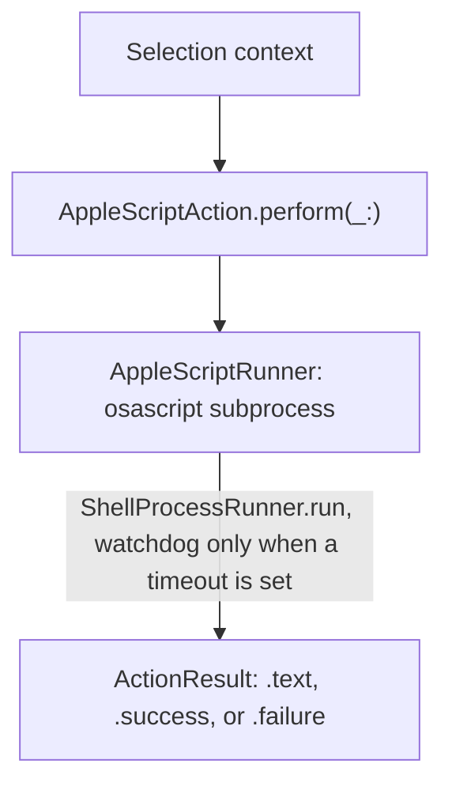

# AppleScript action runtime

The AppleScript action runtime ([`AppleScriptAction`](../../Sources/OpenClip/Platform/Runtimes/AppleScriptAction.swift)) allows OpenClip to automate macOS system applications (such as Safari, Finder, Mail, Notes, and Messages).

## Execution architecture



1. Environment setup: The selected text string is sanitized by escaping double quotes (each `"` becomes `\"`).
2. Variable injection: OpenClip prepends top-level `property` declarations to the script before execution:
  ```applescript
  property OPENCLIP_TEXT : "<escaped_selected_text>"
  property OPENCLIP_HTML : "<escaped_selected_html>"
  property OPENCLIP_RTF : "<escaped_selected_rtf>"
  ```
3. Subprocess execution: The script runs as an `/usr/bin/osascript` subprocess through
    [`AppleScriptRunner`](../../Sources/OpenClip/Platform/AppleScriptRunner.swift), which delegates
    to the shared `ShellProcessRunner` (the same runner used by shell actions, with instant cancellation support).

### Why a subprocess (bounded off-main strategy)

In-process `NSAppleScript.executeAndReturnError()` blocks the calling thread until the target
application answers over Apple Events. It cannot be cancelled, has no timeout, and a hung
`tell application` permanently parks a cooperative-pool thread. `NSAppleScript` is also not
thread-safe across instances. Running each script as a killable subprocess keeps the
cooperative-thread pool free, and a stuck script never wedges a thread forever: callers that want a
bound pass an explicit `timeout` that arms the subprocess watchdog, and without one the script runs
until it exits or the user cancels the loading toast.

`AppleScriptAction` and custom AppleScript actions route through the shared subprocess runner.
The deadline-capped AX inspect in `SelectionRetrievalCoordinator` uses `OnceResume` to guarantee
exactly-once continuation resume between the worker and the deadline. Web selection itself runs
directly over native Accessibility APIs without touching AppleScript.

## Example AppleScript snippets

### Example 1: create new note in macOS notes app

```applescript
tell application "Notes"
 activate
 make new note at folder "Notes" with data OPENCLIP_TEXT
end tell
```

### Example 2: transform selected text to uppercase

```applescript
use framework "Foundation"
use scripting additions

set currentText to NSString's stringWithString:OPENCLIP_TEXT
set upperText to currentText's uppercaseString()
return (upperText as text)
```

## Return values and side effects

`AppleScriptAction` reads the script's stdout (the value osascript prints for the last statement):

- **String Return Value**: If the script returns a non-empty string value, `AppleScriptAction`
  returns `ActionResult.text(str)` for implicitly returned text, delivered per the user's per-click
  preference (preview/paste/copy; a secondary click copies, unless the user set Show in card).
- **No Return Value (empty)**: If the script executes without returning text, it returns `ActionResult.success`.
- **Error Handling**: On a non-zero subprocess exit (the AppleScript error text goes to stderr), the runtime returns `ActionResult.failure(error)` with the error message.
- **Timeout**: Only when the invocation carries an explicit budget. Past it the watchdog terminates `osascript`, the process group when it is the leader, and remaining descendants. Execution surfaces as a timeout failure. With no budget (the default) there is no watchdog; the subprocess runs until it exits or the loading toast cancels it.
